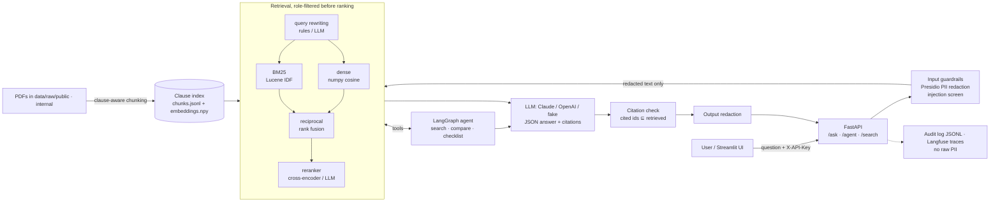

# CompliBot

**An evaluated RAG + agent assistant for Singapore regulatory compliance.** It answers questions over
the MAS Technology Risk Management Guidelines, PDPC PDPA advisory guidelines and the IMDA Model AI
Governance Framework, with a **clause-level citation on every answer**, and says **"I don't know"**
when the documents don't support one.

[](../../actions/workflows/ci.yml)
· Python 3.11+ · FastAPI · Claude API · LangGraph · Presidio · Langfuse · Docker · Cloud Run

| What job postings ask for | Where it is in this repo |
|---|---|
| RAG and agentic workflows (tool calling) | hybrid retrieval + cited answers (`retrieve.py`, `answer.py`); LangGraph tool-calling agent with search / compare / checklist-JSON tools (`agent.py`) |
| Evaluation | recall@k, MRR, refusal accuracy, citation precision, LLM-as-judge faithfulness with judge calibration, latency, cost (`evaluation.py`, `judge.py`); A/B experiments with paired CIs (`experiments.py`) |
| Security and guardrails | permission-aware retrieval, server-side role binding, Presidio PII redaction with Singapore NRIC/phone recognizers, prompt-injection screen, failure handling (`guardrails.py`) |
| Singapore AI governance | AI Verify principles and Model AI Governance Framework self-assessment: [`docs/MODEL_CARD.md`](docs/MODEL_CARD.md) |
| Production | FastAPI, Docker, GitHub Actions (tests + eval gate + image smoke test), Cloud Run guide, Langfuse tracing, Streamlit UI |

## Architecture



## Quickstart (offline, no API keys)

```bash
python -m venv .venv && source .venv/bin/activate
pip install -r requirements.txt && pip install -e .
python -m spacy download en_core_web_sm   # optional: without it, PII redaction uses regex
cp .env.example .env                      # defaults: fake LLM, BM25 only

complibot ingest
complibot ask "Can I paste a customer's NRIC into an AI tool?" --role internal
complibot ask "Can I paste a customer's NRIC into an AI tool?" --role public   # refused: internal doc
complibot agent "Make a checklist for AI incident reporting and customer data" --role internal
complibot eval            # golden-set eval table
pytest                    # 109 tests, offline
streamlit run ui/app.py   # demo UI
```

The repo ships one **fictional** internal policy so this all works out of the box. For the real
corpus, download the PDFs listed in [`data/raw/README.md`](data/raw/README.md), re-run
`complibot ingest`, and check clause detection with `complibot inspect <pdf>`.

**Real LLM:** set `COMPLIBOT_LLM_PROVIDER=anthropic`, `ANTHROPIC_API_KEY` and `ANTHROPIC_MODEL`
(default `claude-opus-5-5`) in `.env`. `openai` works the same way with `OPENAI_MODEL`.

## How an answer is produced

1. **Guardrails.** NRIC/FIN (checksum-validated), +65 phone numbers, emails and card numbers are
   replaced with placeholders (`<NRIC_1>`). Prompt-injection attempts are blocked. Only the redacted
   text flows onward to the LLM, logs and traces.
2. **Retrieve.** Chunks the caller's role may not see are masked out *before* ranking. Then BM25
   (+ dense) for the query (+ rewrites), fused with RRF, optionally reranked, top-k kept.
3. **No hits → refuse** without spending LLM tokens.
4. **Generate.** The LLM gets the clauses as `<source id="S1" doc=… section=… pages=…>` blocks and
   must return JSON `{answer, citations, refused}` (structured outputs).
5. **Verify.** Every cited `S#` (in the list *or* inline) must be a retrieved clause. Otherwise the
   status is `unsupported`. Statuses: `answered` · `refused` · `unsupported` · `blocked` · `error`.
6. **Degrade gracefully.** If the LLM is down, return the top relevant clauses, not a 500.

The agent (`POST /agent`) wraps the same retriever in tools, under a LangGraph `agent ⇄ tools` loop:
`list_documents`, `search_clauses`, `compare_regulations` and `generate_checklist`. The checklist
returns structured JSON, and items not citing a retrieved clause are dropped. The role is bound
server-side, so the model can't pass or widen it, and an internal doc_id looks exactly like a
non-existent one to a public caller.

## Evaluation

`complibot eval` scores a golden set (role-aware, clause-level gold labels, unanswerable and
role-gated items) and saves per-case rows and a summary:

| Group | Metrics |
|---|---|
| Retrieval | recall@1/3/5/10, MRR |
| Refusal | refusal accuracy, false-refusal rate, **unsafe-answer rate** |
| Grounding | supported rate, citation precision, **faithfulness** (LLM judge, per claim) |
| Answer | correctness vs reference (LLM judge) |
| Ops | latency p50/p95, tokens, cost per question (judge cost separate) |

Every mean has a ±95% CI. Infrastructure errors are kept out of the quality metrics. Oracle and null
systems check the harness itself, and `eval-calibrate` measures judge-vs-human agreement. How to grow
the golden set to 100+ items with `eval-generate` + `eval-label`: [`eval/README.md`](eval/README.md).

## Experiments

`complibot experiment --config eval/experiments/offline.json --update-readme` regenerates the table
below. Each row is the baseline with one change, compared **question by question** against the
baseline (`*` = 95% CI excludes 0). `eval/experiments/full.json` runs the same comparison with real
models: Claude Opus 5.5 vs Claude Haiku 5.5, a cross-encoder reranker, LLM query rewriting and OpenAI
embeddings.

> The table below comes from the **offline** config: fake LLM, heuristic judge, a 13-clause fictional
> corpus. It shows the pipeline working, not real-world quality. Replace it with your `full.json`
> run on the real documents.

<!-- experiments:start -->
Golden set: `eval/golden/acme_demo.jsonl` (31 items x 1 rep). Generated 2026-11-22 12:25.

| Experiment | Chunking | Retrieval | LLM | Recall@1 | Recall@5 | MRR | Refusal acc. | Unsafe ans. | Faithful. | Correct. | p50 ms | $/q |
|---|---|---|---|---|---|---|---|---|---|---|---|---|
| Baseline | section | BM25 | fake:fake | 0.85 | 1.00 | 0.93 | 0.61 | 0.57 | 1.00 | 0.94 | 0 | 0.0000 |
| Fixed-size chunks (400 chars, 80 overlap) | fixed | BM25 | fake:fake | 0.83 | 1.00 | 0.92 | 0.65 | 0.57 | 1.00 | 0.53 | 0 | 0.0000 |
| Hybrid: BM25 + dense (hash) | section | BM25+dense(hash) | fake:fake | 0.73 | 1.00 | 0.87 | 0.61 | 0.57 | 1.00 | 0.88 | 0 | 0.0000 |
| Reranker (lexical) | section | BM25 +rerank(lexical) | fake:fake | 0.85 | 1.00 | 0.93 | 0.61 | 0.57 | 1.00 | 0.94 | 1 | 0.0000 |
| Query rewriting (rules) | section | BM25 +rewrite(rules) | fake:fake | 0.90 | 1.00 | 0.96 | 0.61 | 0.57 | 1.00 | 0.94 | 0 | 0.0000 |
| Rewriting + reranker | section | BM25 +rewrite(rules) +rerank(lexical) | fake:fake | 0.90 | 1.00 | 0.96 | 0.61 | 0.57 | 1.00 | 0.94 | 1 | 0.0000 |

Paired difference vs baseline (same questions; ±95% CI; * = CI excludes 0):

| Experiment | Δ Recall@1 | Δ MRR | Δ Refusal acc. | Δ Correctness |
|---|---|---|---|---|
| Fixed-size chunks (400 chars, 80 overlap) | -0.02 ±0.15 | -0.01 ±0.07 | +0.03 ±0.06 | -0.38 ±0.30 * |
| Hybrid: BM25 + dense (hash) | -0.12 ±0.18 | -0.06 ±0.10 | +0.00 | -0.06 ±0.12 |
| Reranker (lexical) | +0.00 ±0.12 | +0.00 ±0.06 | +0.00 | +0.00 |
| Query rewriting (rules) | +0.04 ±0.08 | +0.03 ±0.05 | +0.00 | +0.00 |
| Rewriting + reranker | +0.04 ±0.14 | +0.03 ±0.08 | +0.00 | +0.00 |
<!-- experiments:end -->

What the offline run already shows: fixed-size windows retrieve about as well as clause chunks but
cut clauses mid-sentence, which hurts correctness. A non-semantic "dense" retriever adds noise to the
fusion. A lexical reranker using the same signal as BM25 adds nothing.

## Guardrails, security and reliability

- **Access control:** folder → access level at ingest (unknown folder → internal, fail closed). Role
  from `X-API-Key` (constant-time compare), filter applied before ranking and inside every agent tool.
- **PII:** Presidio + custom Singapore recognizers; regex fallback if Presidio is missing (never
  silently off); output redaction; Presidio's email recognizer pinned offline; the redactor is also
  Langfuse's `mask`.
- **Failure handling:** SDK retries with backoff and timeouts (one retry layer, not two); degraded
  mode; malformed JSON → `error`; agent step limit; tool errors returned to the model; clean 500s
  with `X-Request-ID`.
- **Audit:** `COMPLIBOT_AUDIT_LOG` writes JSONL of role, status, documents, citations and PII
  counts, never question or answer text.
- **Tracing:** set `LANGFUSE_PUBLIC_KEY` and `LANGFUSE_SECRET_KEY` to get one trace per request
  (guardrail → retrieval → LLM generations with tokens and cost → each tool call).

## Deploy

`docker build -t complibot . && docker run -p 8000:8000 --env-file .env complibot`. The image runs as
non-root, honours `$PORT`, has a health check, and builds the index at image build time. Step-by-step
for **Google Cloud Run in `asia-southeast1`** (scale to zero, Secret Manager, budget caps), Render and
Streamlit Community Cloud: [`docs/DEPLOY.md`](docs/DEPLOY.md).

CI (`.github/workflows/ci.yml`) runs on every push: lint, tests on Python 3.11 and 3.12, the offline
eval as a regression gate (plus the oracle/null harness checks), the A/B experiments, and a Docker
build with smoke test. A paid live-model eval runs only when started manually.

## Repository layout

```
src/complibot/
  config.py       settings from env; role -> allowed access levels
  ingest.py       PDF/TXT/MD -> clean lines -> clause segments -> chunks (section | fixed)
  store.py        chunks.jsonl + embeddings.npy + meta.json
  embeddings.py   none | hash (offline) | openai
  retrieve.py     BM25 (Lucene IDF) + dense + RRF; role and document filters before ranking
  rewrite.py      query rewriting (rules glossary | LLM), multi-query fusion
  rerank.py       rerankers (lexical | cross-encoder | LLM)
  llm.py          anthropic | openai | fake; JSON completion + tool-calling chat; cost table
  answer.py       prompt, citation validation, refusal, degradation, audit; CompliBot facade
  agent.py        LangGraph agent and tools (search, compare, checklist JSON)
  guardrails.py   Presidio PII redaction (SG NRIC/FIN, phone), injection screen
  tracing.py      optional Langfuse tracing with PII masking
  judge.py        LLM-as-judge: faithfulness (per claim), correctness; offline heuristic judge
  evaluation.py   golden set, metrics, 95% CIs, oracle/null baselines, results table
  experiments.py  A/B runner, paired deltas, markdown table
  labeling.py     golden-set candidate generation + interactive labelling
  api.py          FastAPI app
  cli.py          ingest | inspect | search | ask | agent | serve | eval | experiment | eval-*
ui/app.py         Streamlit demo (in-process or against the API)
tests/            pytest; fixture documents clearly marked FAKE
eval/             golden sets, judge calibration set, experiment configs, results
data/raw/         public/ and internal/ (folder = access level), catalog.json
docs/             DEPLOY.md · MODEL_CARD.md · DEMO_SCRIPT.md · RESUME.md
```

## Limitations

Clause detection is heuristic (check new PDFs with `complibot inspect`). The bundled demo corpus is
tiny and fictional. Offline scores (fake LLM) only check the plumbing. This is a decision-support
tool, not legal advice: always read the cited clause. More in [`docs/MODEL_CARD.md`](docs/MODEL_CARD.md).
